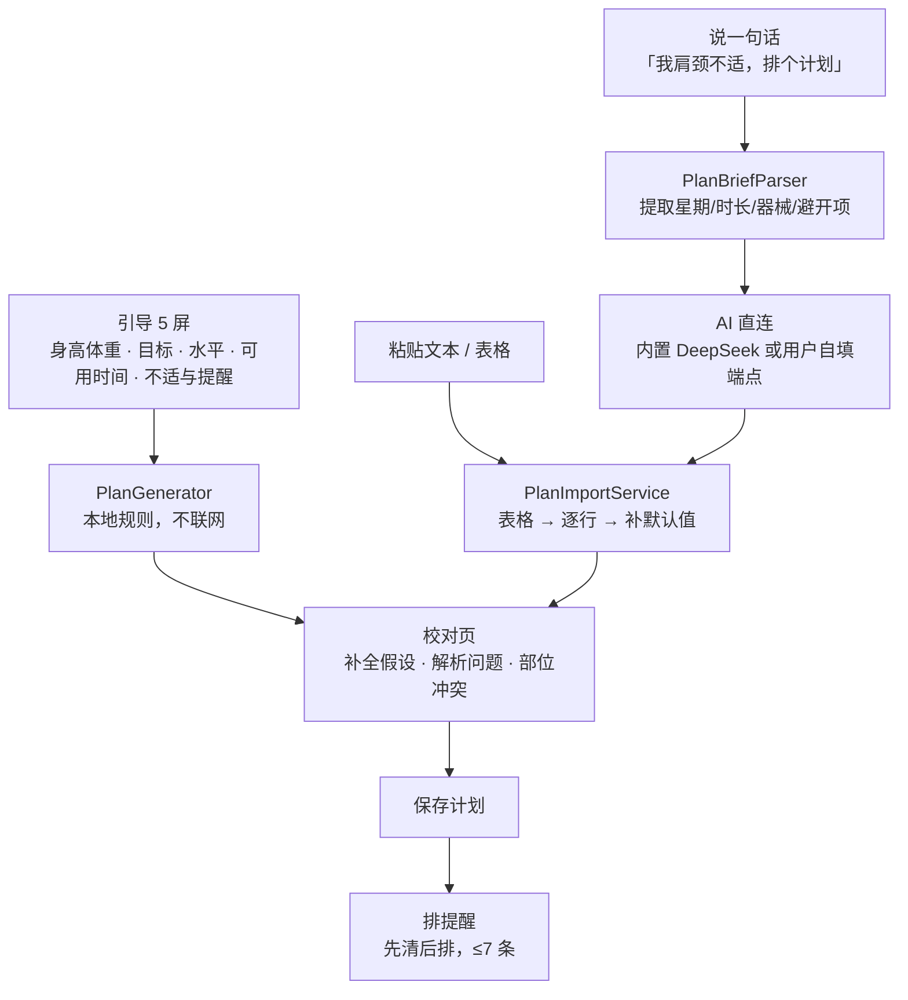
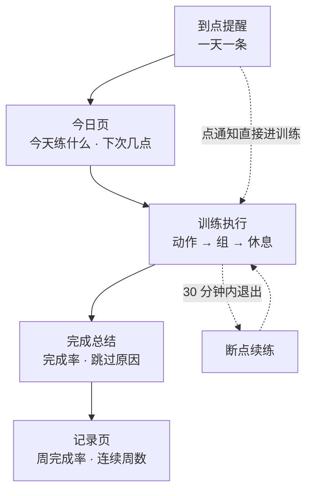

# App 主流程

**本文是流程图的唯一维护点。** 改动任何入口、跳转或保存时机，同步改这里。`ARCHITECTURE.md` 已冻结，只作存档依据，不要往那边加。

一句话概括：**三条入口进同一份计划，计划保存即排提醒，提醒到点就照着练，练完留下记录。**

## 图 1 计划从哪来：三条入口，一个出口



## 图 2 计划怎么被用掉：提醒 → 执行 → 记录



计划页的三个入口（导入、说一句、动作库）在 `AppShell` 的 `plan` 标签下；训练页是 `fullScreenCover` 全屏盖在上面，不进标签栈。

## 1 冷启动：不配置也有计划

`RootView` 只看一个状态 `hasOnboarded`。没有就走 5 屏引导，有就直接进 `AppShell`。

引导最后一屏点「完成」时，`RootView.finish` 立刻做四件事：

```swift
profiles.save(profile)
planStore.save(PlanGenerator.makePlan(profile: profile))   // 本地规则，零网络
notifications.requestAuthorization()                        // 只在用户开了提醒时
notifications.reschedule(plan:settings:)                    // ≤7 条
```

**这一步是产品的地基**：用户什么都不导入、不配 Key，打开就有一份自己的计划。AI 和粘贴导入都是「换掉这份计划」的手段，不是使用前提。

## 2 计划从哪来：三条入口，一个出口

| 入口 | 位置 | 要不要网络 | 要不要额外交互 |
|---|---|---|---|
| 引导生成 | 引导最后一屏，自动 | 不要 | 无 |
| 粘贴导入 | 计划页 → 导入计划 | 不要 | 粘贴 → 识别 |
| 一句话生成 | 计划页顶部「说一句，让 AI 排」 | **要** | 输入 → 理解确认 |

三条都**必须**经过校对页才能落库。校对页展示三样东西：解析时的补全假设、结构问题、以及按不适部位算出的冲突动作。

> 2026-10-24 修过一个违反此处的 bug：`QuickAIPlanSheet` 拿到生成结果直接 `planStore.save`，跳过校对页，等于 AI 生成什么就覆盖现有计划，用户没有反悔机会。已改为 push 进校对页，点保存才落库。

## 3 计划怎么被用掉：提醒 → 执行 → 记录

- **提醒**：保存计划即重排，先清掉旧的再排新的，上限 7 条（一周一天一条）。时刻取 `day.scheduledTime`，没有就用设置里的默认时间——所以 AI 不给时间也能排。
- **执行**：训练页是 `fullScreenCover`，进去先看动作要点，再按组推进，组间进休息页。三种结局：完成、降阶、跳过（跳过要选原因）。
- **断点**：中途退出，30 分钟内进来有「继续上次」的入口；超过 30 分钟视为放弃。
- **记录**：总结页落库，记录页按周统计完成率。

## 4 画图时最容易漏的四条

1. **`activePlan` 有兜底**：`planStore.plan ?? PlanGenerator.makePlan(profile)`。数据库里没有计划时不会空白，而是现算一份。
2. **通知深链能直接进训练页**，不经过今日页。两条路径：按 `dayIndex`、按 `weekday`。
3. **计划页的行是可点的**：某天行 → 当天详情 → 动作详情。动作详情只在动作属于库内时可达，库外动作显示「自定义」且不可点。
4. **AI 是可选加速器，不是必经路径**。断网、不配 Key、DeepSeek 挂掉，前两条入口与全部执行链路都不受影响。

## 5 已知缺口（流程图暂时画不出来的部分）

| 缺口 | 现状 | 记录在哪 |
|---|---|---|
| 计划只有「避开」没有「缓解」 | 部位冲突只做减法，康复向动作库里没有 | `docs/specs/BACKLOG.md` §1 |
| 臀部主力动作只有臀桥 1 个 | 膝不适 + 练臀时模型会造「臀推」「单腿臀桥」 | `docs/specs/BACKLOG.md` §2 |
| 计划总量不稳定 | 同一句话 15~28 个动作 | `docs/specs/BACKLOG.md` §3 |
| 库外动作不是 0 而是不稳定命中 | 单次采样全绿不代表修完 | `.scratch/plan-content-policy/README.md` |
