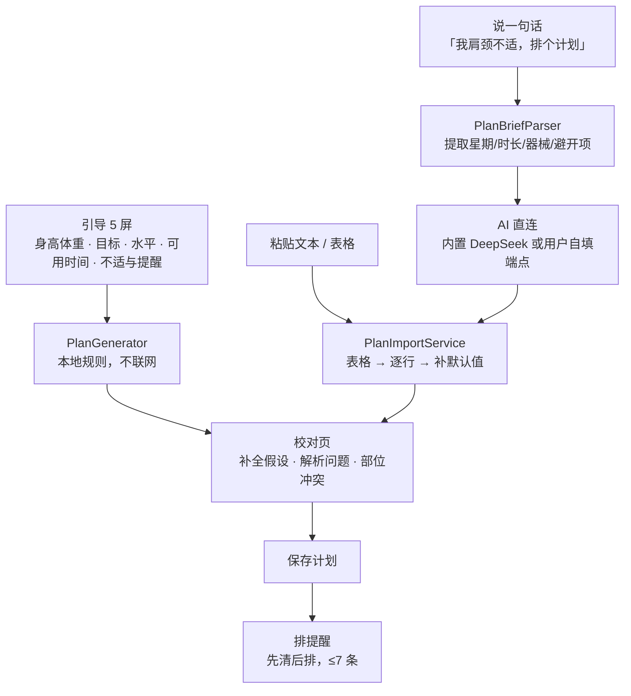
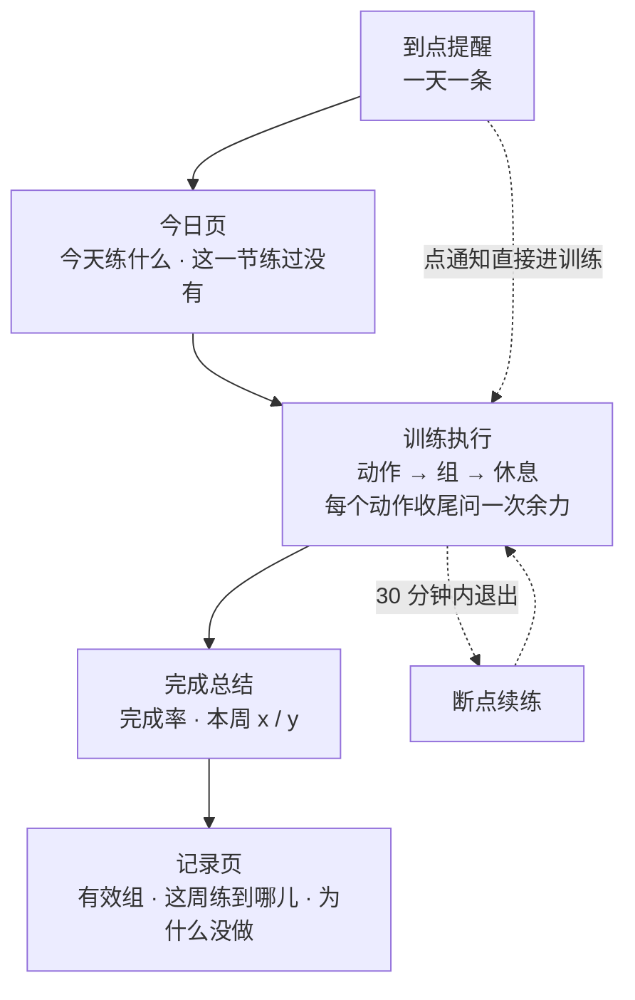
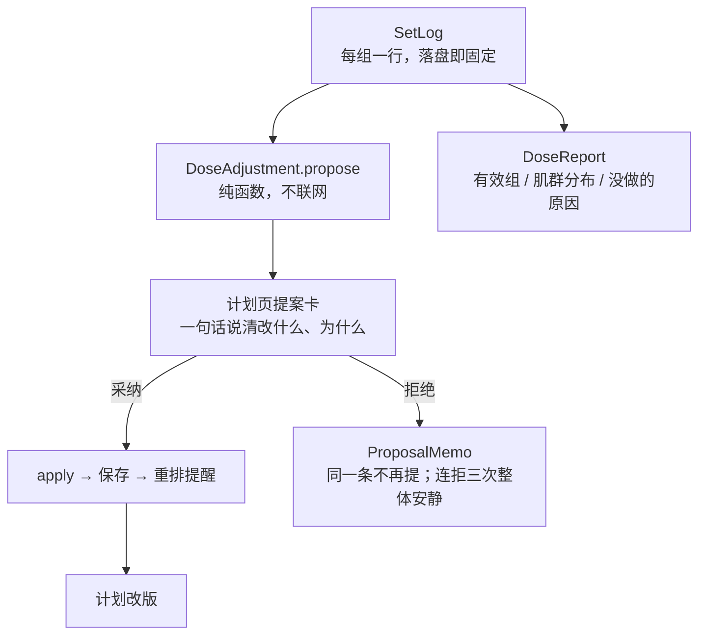

# App 主流程

**本文是流程图的唯一维护点。** 改动任何入口、跳转、保存时机或归属口径，同步改这里。结构与契约写进 `ARCHITECTURE.md`（它的 §4–§11 是硬约束），流程图只在本文件，两边不重复画同一张图。

一句话概括：**三条入口进同一份计划，计划保存即排提醒，提醒到点就照着练，练完留下记录；记录攒够了变成提案，而计划只为用户点的那个「采纳」而变。**

## 图 1 计划从哪来：三条入口，一个出口



## 图 2 计划怎么被用掉：提醒 → 执行 → 记录



## 图 3 计划怎么变：记录 → 提案 → 采纳

**这张图是本项目最硬的一条规矩**（ADR-0004）：没有任何路径让计划自己变。



四类提案，一次只出一张：`保护`（疼）> `重建`（停练太久）> `换动作`（没器械）> `剂量`（加量 / 减量 / 降量）。

计划页的三个入口（导入、说一句、动作库）在 `AppShell` 的 `plan` 标签下；训练页是 `fullScreenCover` 全屏盖在上面，不进标签栈。

## 1 冷启动：不配置也有计划

`RootView` 只看一个状态 `hasOnboarded`。没有就走 5 屏引导，有就直接进 `AppShell`。

引导最后一屏点「完成」时，`RootView.finish` 立刻做四件事：

```swift
profiles.save(profile)
planStore.save(PlanGenerator.makePlan(profile: profile))   // 本地规则，零网络
notifications.requestAuthorization()                        // 只在用户开了提醒时
notifications.reschedule(plan:settings:)                    // ≤7 条
```

**这一步是产品的地基**：用户什么都不导入、不配 Key，打开就有一份自己的计划。AI 和粘贴导入都是「换掉这份计划」的手段，不是使用前提。

## 2 计划从哪来：三条入口，一个出口

| 入口 | 位置 | 要不要网络 | 要不要额外交互 |
|---|---|---|---|
| 引导生成 | 引导最后一屏，自动 | 不要 | 无 |
| 粘贴导入 | 计划页 → 导入计划 | 不要 | 粘贴 → 识别 |
| 一句话生成 | 计划页顶部「说一句，让 AI 排」 | **要** | 输入 → 理解确认 |

三条都**必须**经过校对页才能落库。校对页展示三样东西：解析时的补全假设、结构问题、以及按不适部位算出的冲突动作。

> 2026-10-24 修过一个违反此处的 bug：`QuickAIPlanSheet` 拿到生成结果直接 `planStore.save`，跳过校对页，等于 AI 生成什么就覆盖现有计划，用户没有反悔机会。已改为 push 进校对页，点保存才落库。

**这三条都是「换一份计划」。第四条路是「改这份计划」，只有提案一条，见图 3。**

## 3 计划怎么被用掉：提醒 → 执行 → 记录

- **提醒**：保存计划即重排，先清掉旧的再排新的，上限 7 条（一周一天一条）。时刻取 `day.scheduledTime`，没有就用设置里的默认时间——所以 AI 不给时间也能排。
- **执行**：训练页是 `fullScreenCover`，进去先看动作要点，再按组推进，组间进休息页。三种结局：完成、降阶、跳过（跳过要选原因）。
- **余力**：**每个动作的最后一组**问一次「还剩几次力气」，不选也行。它只被记成弱证据（连续两次说还能做三次以上 ⇒ 只加次数），不进完成率。
- **断点**：中途退出，30 分钟内进来有「继续上次」的入口；超过 30 分钟视为放弃。
- **记录**：每组落盘时**连同「这次兑现的是哪一节」一起写**（`planDate`），不是等结束再补。总结页与记录页都按这个日期归属。

### 3.1 「今天该练哪一节」只有一个函数

`PlanCalendar.occurrence(on:in:)`：今天是训练日就是今天，否则是**下一个**训练日（可跨周）。今日页的卡片、启动按钮、通知深链、断点续练全走它——以前卡片与按钮各算一次，于是周二休息日卡片写「下次训练 周三」，点下去开的是**本周第一个训练日**（已过去的周一）。

### 3.2 提前练：那一节记在它自己的那一周

休息日点「提前练一次」，练的是卡片上写的那一节，记在**那一节本来的日期**上。周日提前练下周一的课 ⇒ 下周一那周 1/3，本周仍是 0/3（本周那三节确实没练）。

反过来记在周日那周会让周一同时出现「这一节已经练过」和「本周 0/3」——界面自己打自己，所以不选。

### 3.3 「练过」与「练完」不是一回事

| 判断 | 口径 | 用在哪 |
|---|---|---|
| 这一节练过没有 | 有该 `planDate` 且**全部组完成**的会话 | 今日页：已练过 ⇒ 按钮变「再练一次」，藏掉「今天不练」 |
| 本周练了几节 | 本周内 `planDate` 不同且全部组完成的会话数 | 今日页进度条、结束页「本周 x / y」 |
| 连续多少天 | 按会话**发生日期**去重，不看 `planDate` | 记录页 |

第三个和前两个口径不同是故意的：一个问「你多久没断」，一个问「本周的账」。周日提前练会让连续天数 +1、本周仍是 0/3。

## 4 计划怎么变：记录 → 提案 → 采纳

**记录只写日志，从不直接改计划。** 训练中多做了几个、少做了一组、标了疼，都只是那天的账；能不能变成计划的一部分，要看证据攒够没有，并且由用户在计划页点「采纳」。

| 输入 | 门槛 | 提案 |
|---|---|---|
| 连续两次、**每组**都 ≥ 目标 + 1 | 2 次会话 | 加量：次数 → 负重 → 组数，取最低一档 |
| 连续两次、**最后一组**说还能做三次以上 | 2 次会话 | 加量：**只加次数 +2**，负重与组数不动 |
| 同一动作连续两次标「太累」 | 2 次会话 | 剂量：负重 ×0.9 或次数 −2，组数不动 |
| 同一动作最近三次都标「没时间」，且那天动作 > 5 个 | 3 次会话 | 剂量：砍掉那个动作 |
| 一次标「疼」 | 7 天内 | **保护**：这个动作减 20%（负重 → 次数 → 组数，组数最低 1） |
| 上次因「没器械」跳过，且有替代动作 | 1 次 | **换动作**：换成库内绕开器械的那一条 |
| 连续两天没练（`missedPlanDays ≥ 2`） | — | **重建**：规模回到八成，不动 revision |

拒绝会被记住：同一条不再提，连拒三次整体安静，**只有采纳才清零**。降量绕过拒绝记忆——疼和崩这件事，系统宁可重复一次。

计划页的提案卡在 `plan.revision` 变化时重算一次（`.task(id: plan.revision)`），采纳后保存并重排提醒。

## 5 画图时最容易漏的六条

1. **`activePlan` 有兜底**：`planStore.plan ?? PlanGenerator.makePlan(profile)`。数据库里没有计划时不会空白，而是现算一份。
2. **通知深链能直接进训练页**，不经过今日页。两条路径：按 `dayIndex`、按 `weekday`；指向休息日的深链直接不启动。
3. **计划页的行是可点的**：某天行 → 当天详情 → 动作详情。动作详情只在动作属于库内时可达，库外动作显示「自定义」且不可点。
4. **AI 是可选加速器，不是必经路径**。断网、不配 Key、DeepSeek 挂掉，前两条入口与全部执行链路都不受影响。
5. **一次会话记着自己兑现的是哪一天**（`SessionEntity.planDate`，可选）。缺这个字段，提前练没处归属、训练日无法去重、结束页说不出「本周到哪儿」。旧数据为 nil 时回落到会话发生日期。
6. **剂量规则是纯函数，不碰库也不碰网络**：`DoseAdjustment.propose(DoseContext) -> PlanProposal?`，`nil` 就是沉默。所有「什么时候该说话」的判断题都在 `DongKeCore/Workout/`，不在视图里。

## 6 已知缺口（流程图暂时画不出来的部分）

| 缺口 | 现状 | 记录在哪 |
|---|---|---|
| 纯自重池撑不满五天 | 60 分钟 × 5 天：臀 42 组。降组数 / 降频率两条路都还没走 | `docs/specs/BACKLOG.md` §13 |
| 跳过（今天不练）与提前练的关系没定 | 跳过只减分母，不影响 `planDate`；跳过的那节就空着 | `docs/specs/BACKLOG.md` §14 |
| 会话级「今天再加一组」 | 余力只走计划级，下次训练生效；改会话级要同时定完成率与有效组的分母 | `docs/specs/BACKLOG.md` §15 |
| 跟练类成套内容（五禽戏一类） | 说「我想跟练五禽戏」会被静默排成一份深蹲计划 | `docs/specs/BACKLOG.md` §7 |
| 库外动作不是 0 而是不稳定命中 | 单次采样全绿不代表修完 | `.scratch/plan-content-policy/README.md` |
